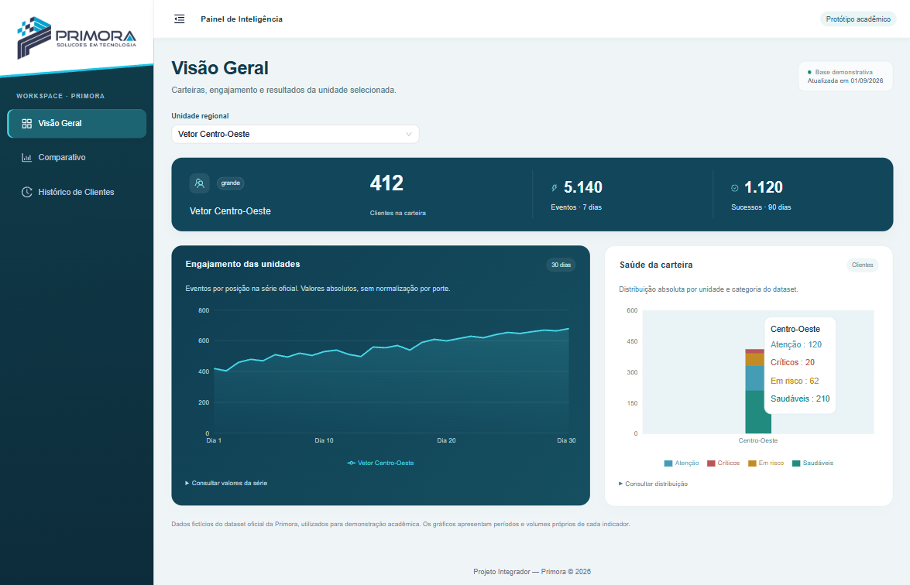
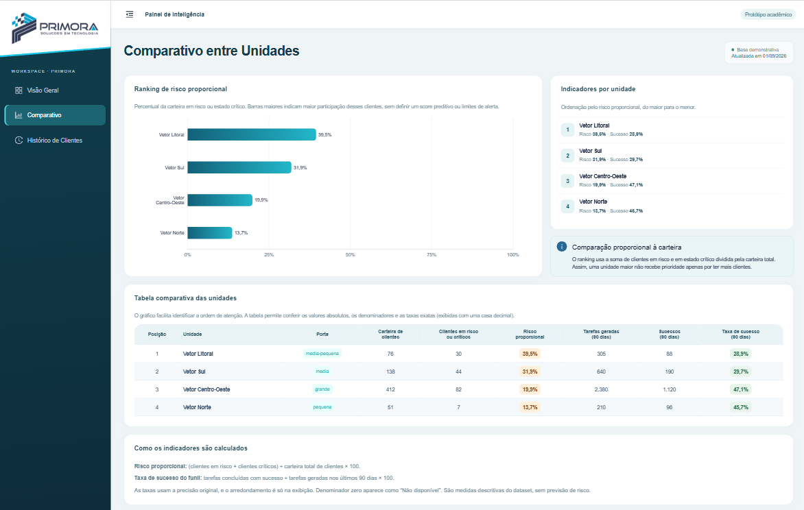
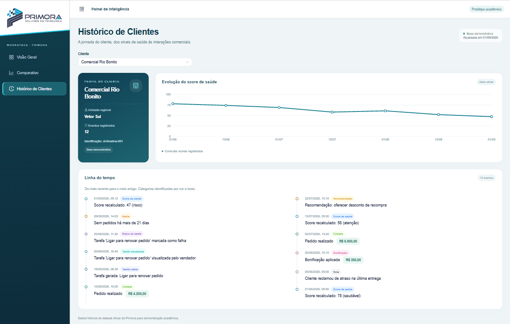
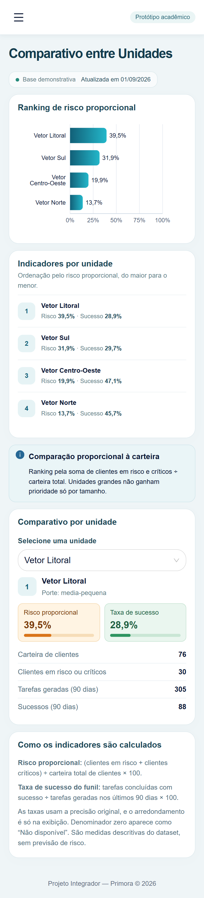
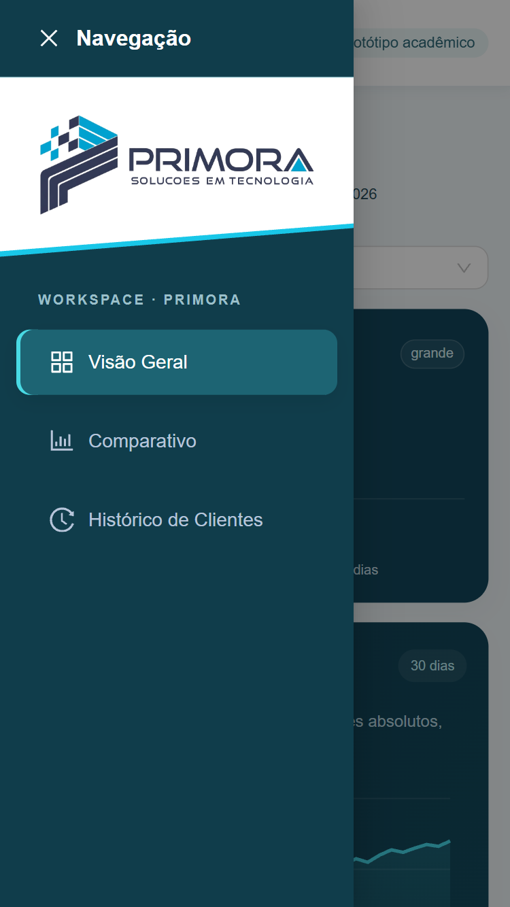
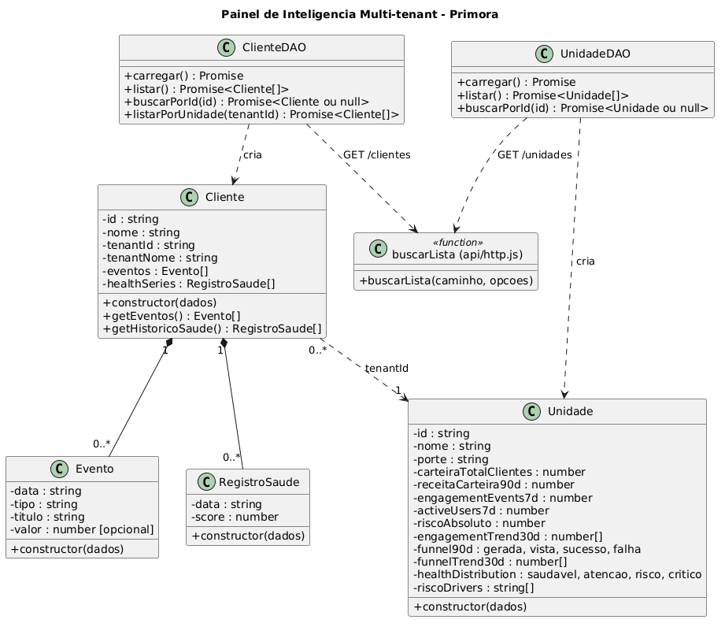

# Primora: Painel de Inteligência Multi-tenant

Projeto Integrador do programa **Bolsa Futuro Digital (BFD)**, desenvolvido para a empresa parceira **Primora**.

A Primora atende várias unidades (tenants) e precisa acompanhar, em um só lugar, a situação de cada uma e o histórico de seus clientes. Este projeto é um **protótipo acadêmico** de painel web que resolve isso: mostra os indicadores de cada unidade, compara as unidades de forma proporcional ao porte e exibe a linha do tempo de eventos de cada cliente. Todos os dados usados são **simulados**.

---

## Deploy da aplicação

- **Front-end (publicado no Vercel):** https://painel-primora.vercel.app
- **API usada pela versão publicada:** back-end próprio do grupo, hospedado no Render: https://primora-backend-wihg.onrender.com (endpoints `/unidades` e `/clientes`).
- **API do professor (n8n):** endpoints GET para desenvolvimento e testes, descritos em [Integração com API REST](#integração-com-api-rest).

## Repositórios do projeto

- **Front-end (este repositório):** https://github.com/guilhermelima2705/desafio-primora-painel-inteligencia
- **Back-end próprio do grupo (ASP.NET Core e PostgreSQL):** mantido em repositório separado, não disponível publicamente.

## Visão geral

- **Domínio:** gestão e acompanhamento de unidades (tenants) e clientes.
- **Entidades principais:** Unidade e Cliente. Cada cliente tem Eventos e Registros de Saúde.
- **Objetivo:** apresentar indicadores por unidade, comparar unidades considerando o porte e mostrar o histórico de cada cliente.
- **Origem dos dados:** a aplicação consulta dois endpoints GET. Os dados são simulados, e a base de referência é o arquivo `src/data/dataset_painel_multitenant.json`, fornecido pela empresa (4 unidades e 3 clientes).
- **Persistência:** não há. O front-end apenas lê os dados.
- **Multi-tenant:** o termo se refere à visualização de unidades fictícias. Não há autenticação nem isolamento real de dados.

## Tecnologias utilizadas

- React 19 e React DOM
- JavaScript (ES6+) e JSX
- Vite 8
- Ant Design 6 e Ant Design Icons 6
- React Router 8
- Recharts 3 (gráficos)
- CSS próprio (layout responsivo)
- ESLint 10
- Testes com `node --test`

As versões exatas estão no `package-lock.json`.

## Desafio atendido

Funcionalidades implementadas:

- Navegação entre três telas, com menu lateral que vira menu em gaveta (Drawer) no celular.
- **Visão Geral:** seleção de uma entre as quatro unidades, com cartão da carteira, eventos de engajamento de 7 dias, funil de 90 dias e gráficos de engajamento e saúde da carteira.
- **Comparativo entre Unidades:** tabela, ranking e gráfico de risco proporcional das quatro unidades.
- **Histórico de Clientes:** seleção de um entre os três clientes, com identificação, unidade, série de score de saúde e timeline de eventos.
- Consumo dos dados por API REST (`fetch`), com estados de carregando, erro (com botão "Tentar novamente") e lista vazia.
- Camada de modelos e DAOs.

Limitações conhecidas:

- Os dados são simulados e a API disponível só aceita GET. Não há cadastro, edição nem exclusão.
- Não há autenticação nem isolamento real entre tenants.
- Alguns campos do JSON são carregados nos modelos, mas não são exibidos nas telas: `receitaCarteira90d`, `activeUsers7d`, `funnelTrend30d` e `riscoDrivers`.
- Os valores do Comparativo são indicadores descritivos, não previsões.
- A seleção de unidade e de cliente volta ao valor inicial ao sair e voltar para a tela, pois não há persistência.

## Requisitos funcionais (RF)

| Código | Requisito | Situação |
| --- | --- | --- |
| RF01 | Navegar entre as três telas pelo menu, com a tela ativa destacada | Atendido |
| RF02 | Selecionar uma unidade e ver seus indicadores (carteira, engajamento, funil) | Atendido |
| RF03 | Ver gráficos de engajamento e de saúde da carteira da unidade selecionada | Atendido |
| RF04 | Comparar as quatro unidades por risco proporcional ao porte, em tabela, ranking e gráfico | Atendido |
| RF05 | Selecionar um cliente e ver sua identificação e a unidade a que pertence | Atendido |
| RF06 | Ver a série de score de saúde do cliente | Atendido |
| RF07 | Ver a timeline de eventos do cliente, do mais recente ao mais antigo | Atendido |
| RF08 | Carregar os dados por API REST, com tratamento de carregando, erro e lista vazia | Atendido |

## Requisitos não funcionais (RNF)

| Código | Requisito | Situação |
| --- | --- | --- |
| RNF01 | Aplicação em ReactJS com Vite | Atendido |
| RNF02 | Interface com Ant Design | Atendido |
| RNF03 | Comunicação com a API REST via `fetch` | Atendido |
| RNF04 | Padrão DAO para acesso aos dados | Atendido |
| RNF05 | Modelos com atributos privados, getters e validação | Atendido |
| RNF06 | Responsividade (testada em 320, 390, 768 e 1440 pixels) | Atendido |
| RNF07 | Código organizado por pastas e responsabilidades | Atendido |
| RNF08 | Testes automatizados dos modelos, DAOs, API e indicadores | Atendido |
| RNF09 | Dados identificados como simulados na interface | Atendido |

## Telas da aplicação

**Visão Geral (computador)**



**Comparativo entre Unidades**



**Histórico de Clientes (computador)**



**Comparativo entre Unidades (celular)**



**Menu em gaveta no celular**



## Modelagem dos dados

Diagrama de classes (arquivo-fonte em PlantUML: [`docs/diagrama-classes.puml`](docs/diagrama-classes.puml)):



| Classe | Descrição | Principais atributos |
| --- | --- | --- |
| `Unidade` | Unidade (tenant) da Primora | `id`, `nome`, `porte`, `carteiraTotalClientes`, `engagementEvents7d`, `funnel90d`, `healthDistribution`, `riscoAbsoluto` e outros |
| `Cliente` | Cliente ligado a uma unidade pelo `tenantId` | `id`, `nome`, `tenantId`, `tenantNome`, eventos e série de saúde |
| `Evento` | Evento da timeline do cliente | `data`, `tipo`, `titulo`, `valor` (opcional) |
| `RegistroSaude` | Ponto da série de saúde do cliente | `data`, `score` (de 0 a 100) |

Relacionamentos: um `Cliente` pertence a uma `Unidade` (vínculo por `tenantId`) e possui vários `Evento` e vários `RegistroSaude`. Eventos e registros de saúde são coleções internas do cliente e não têm DAO próprio.

Os modelos usam atributos privados (`#`), getters que devolvem cópias dos dados e validação que lança `TypeError` para dados inválidos. Os objetos são congelados com `Object.freeze`.

## Integração com API REST

O front-end consome a API apenas com requisições **GET**. Os dados são do dataset **fictício** da Primora (4 unidades e 3 clientes). A URL base fica na variável `VITE_API_BASE_URL`, e o front-end acrescenta `/unidades` ou `/clientes`. Nenhuma credencial é necessária.

**Versão publicada (back-end próprio do grupo, no Render):**

| Método | Endpoint | Uso |
| --- | --- | --- |
| GET | `https://primora-backend-wihg.onrender.com/unidades` | Lista das 4 unidades. Alimenta a Visão Geral e o Comparativo |
| GET | `https://primora-backend-wihg.onrender.com/clientes` | Lista dos 3 clientes. Alimenta o Histórico de Clientes |

**API do professor (n8n), usada em desenvolvimento e testes:**

| Método | Endpoint | Uso |
| --- | --- | --- |
| GET | `https://n8n.incluc0de.com.br/webhook/primora/v1/unidades` | Lista das 4 unidades |
| GET | `https://n8n.incluc0de.com.br/webhook/primora/v1/clientes` | Lista dos 3 clientes |

As duas APIs entregam o mesmo formato de dados (uma lista em JSON), então o front-end funciona com qualquer uma delas, bastando trocar a `VITE_API_BASE_URL`.

**Fluxo dos dados:** tela, hook `useListaDataset`, DAO (`UnidadeDAO` ou `ClienteDAO`), função `buscarLista` (`src/api/http.js`) e, por fim, o modelo (`Unidade` ou `Cliente`).

| Classe DAO | Métodos assíncronos |
| --- | --- |
| `UnidadeDAO` | `carregar()`, `listar()`, `buscarPorId(id)` |
| `ClienteDAO` | `carregar()`, `listar()`, `buscarPorId(id)`, `listarPorUnidade(tenantId)` |

Buscas sem resultado retornam `null` e listagens vazias retornam `[]`. O contrato dos DAOs foi definido para a atividade acadêmica e não é uma API oficial da Primora.

**Tratamento de erros** (`buscarLista`): falta da variável de ambiente, falha de conexão, resposta HTTP diferente de sucesso, JSON inválido e formato inesperado (que não seja uma lista). Nessas situações a tela mostra um aviso de erro e o botão "Tentar novamente". O carregamento usa `AbortController` para cancelar a consulta ao sair da tela.

**Filtros e apresentação:** o front-end filtra os dados no navegador. A unidade e o cliente selecionados são localizados por `id`. O Comparativo calcula o risco proporcional como (risco + crítico) dividido pela carteira total, e a taxa de sucesso do funil como sucesso dividido por tarefas geradas. As fórmulas estão em `src/pages/Comparativo/README.md`.

## Estrutura do projeto front-end

```text
.
├── docs/                    (diagrama UML e imagens do README)
├── public/
├── scripts/                 (testes de navegador das Sprints 4 e 6)
├── src/
│   ├── api/                 (http.js: fetch e tratamento de erros)
│   ├── assets/              (logo e imagens)
│   ├── components/          (componentes reutilizáveis)
│   │   └── layout/          (layout, menu lateral e Drawer)
│   ├── dao/                 (UnidadeDAO e ClienteDAO)
│   ├── data/                (dataset JSON de referência)
│   ├── hooks/               (useListaDataset)
│   ├── models/              (Unidade, Cliente, Evento, RegistroSaude, validacao)
│   ├── pages/
│   │   ├── VisaoGeral/
│   │   ├── Comparativo/
│   │   └── HistoricoClientes/
│   ├── routes/              (AppRoutes.jsx)
│   ├── styles/              (CSS global)
│   ├── App.jsx
│   └── main.jsx
├── tests/
│   ├── sprint5/             (modelos e DAOs)
│   └── sprint6/             (camada HTTP)
├── .env.example
├── package.json
└── vite.config.js
```

Rotas: `/` (Visão Geral), `/comparativo` e `/historico-clientes`. Qualquer outro endereço redireciona para `/`.

## Execução local

**Pré-requisitos:** Git, Node.js `^20.19.0` ou `>=22.12.0` e npm.

```bash
git clone https://github.com/guilhermelima2705/desafio-primora-painel-inteligencia.git
cd desafio-primora-painel-inteligencia
cp .env.example .env.local
npm ci
npm run dev
```

No Windows (PowerShell), use `Copy-Item .env.example .env.local` e `npm.cmd` no lugar de `npm`.

**Configuração da API:** abra o `.env.local` e defina a URL base da API. Para rodar com a API do professor:

```text
VITE_API_BASE_URL=https://n8n.incluc0de.com.br/webhook/primora/v1
```

Para usar o back-end do grupo publicado no Render:

```text
VITE_API_BASE_URL=https://primora-backend-wihg.onrender.com
```

Reinicie o `npm run dev` depois de alterar o arquivo. Acesse `http://localhost:5173`. O `.env.local` não vai para o GitHub. O `.env.example` do repositório aponta para `https://localhost:7246` (o back-end rodando na máquina do desenvolvedor), por isso quem clonar deve usar uma das duas URLs acima.

**Validação:**

```bash
npm run lint
npm run build
node --test tests src/pages/Comparativo/indicadores.test.js
```

## Autoria

- Guilherme de Souza Lima
- Erika Priscilla Ferreira Rocha da Silva
- Tamires dos Santos Ramos

Curso: Desenvolvimento de Software com Formação Front-End React.
Instituição: Instituto Federal de Brasília (IFB), Campus Taguatinga.
Projeto: Projeto Integrador, Bolsa Futuro Digital (BFD). Empresa parceira: Primora.

## Considerações finais

Resultados: o painel entrega as três telas pedidas pela Primora, com dados vindos de API REST, camada de modelos e DAOs, interface responsiva e testes automatizados.

Dificuldades:

- Deixar as telas responsivas, principalmente os gráficos, a tabela do Comparativo e a linha do tempo do Histórico em telas pequenas.
- Integrar os dados por API REST e tratar os casos de carregamento, erro e nova tentativa.
- Organizar o trabalho em equipe com branches e Pull Requests.
- Entender e manter a separação em camadas (tela, hook, DAO e modelo).

Possíveis melhorias:

- Exibir os campos que hoje não aparecem nas telas (`receitaCarteira90d`, `activeUsers7d`, `funnelTrend30d` e `riscoDrivers`).
- Persistir a seleção de unidade e de cliente.
- Adicionar autenticação e isolamento real entre tenants, caso o projeto evolua além do protótipo.
- Evoluir a API para aceitar cadastro e edição, hoje apenas leitura.
